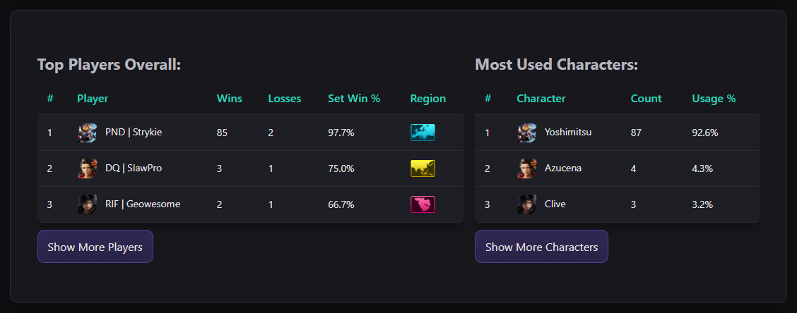

# DQRetro's Tekkenball-Brackets

🌐 Live site: [dqretro.github.io/tekkenball-brackets](https://dqretro.github.io/tekkenball-brackets/)
---

---

## Features & Pages
This project provides a full front-end for **Tekken Ball tournaments, statistics, and media**.  

- **Tournaments** – brackets, matches, standings, players, and event overviews.  
- **Global Statistics** – most used characters, leaderboards, and resettable filters.  
- **Leaderboards** – sortable results across all tracked events.  
- **Player Profiles** – track individual performance and match history.  
- **Video Gallery** – curated YouTube videos dynamically loaded from the Tournament Tracker API.  
- **Updates & Integration** – API-driven content with seamless navigation and UI consistency.  

---

## start.gg API Integration
Tournament data is powered by **start.gg API integration**.  

- Pulls live tournament data directly from **start.gg**.  
- Provides details for **events, brackets, players, standings, and matches**.  
- Keeps the tournament pages synced with official start.gg records.  
- Ensures accuracy and automation for DQRetro’s Tekken Ball tournament coverage.  
- 🔗 Reference: [start.gg API Documentation](https://developer.start.gg/)  

---

## Video Gallery Integration
The **Gallery** page directly integrates with the Tournament Tracker API.  

- `gallery.js` fetches videos directly from the API.  
- Videos are dynamically filtered by **year** and displayed with thumbnails linking to YouTube.  
- Fully synced with DQRetro's content.  

---

## Contributors
- **Sky Williamson** – [GitHub Profile](https://github.com/SlawSimulation)  
- **Harry Mather** – [GitHub Profile](https://github.com/HarryCMather)  

---

## Data Updates & Deployment
The site is fully static and runs on **GitHub Pages**. Everything is automated with **GitHub Actions**, so no server or database is needed.

- **Daily data refresh:** the start.gg sync tool (`src/DQRetro.TournamentTracker.Startgg`) finds DQRetro and SRKade tournaments plus DQRetro events at VSFighting (see below) and rewrites `brackets.json` and `players.json` in `src/DQRetro.TournamentTracker.Ui/public/data/`.
- **Safe by default:** the data is validated before it is committed or published. A rejected key, an empty fetch or a sudden large drop in tournaments never overwrites the existing data.
- **Automatic deploy:** when the data changes, the site is republished to GitHub Pages.

| Workflow | Runs on | What it does |
|---|---|---|
| `ci.yml` | Pushes and pull requests | Checks no secrets or build files are committed, builds the sync tool and validates the data. |
| `refresh-data.yml` | Daily at 05:17 UTC, or **Actions → Refresh start.gg data → Run workflow** | Fetches fresh start.gg data and commits only the two data files if they changed, then deploys. |
| `static.yml` | Pushes to `main`, or manually | Validates the data and publishes the site to GitHub Pages. |
| `deploy-twitch-worker.yml` | Changes to `workers/twitch-live/` on `main`, or manually | Deploys the Twitch live-status Worker to Cloudflare (see *Live stream overlay*). |

### Repository settings (maintainers)
- **Settings → Pages → Source:** GitHub Actions.
- **Settings → Secrets and variables → Actions:**

| Secret | Purpose |
|---|---|
| `STARTGG_API_KEY` | start.gg API token used by the data refresh. Paste only the key itself. |
| `YOUTUBE_API_KEY` | YouTube Data API key for the Video Gallery, written into the site at deploy time. Restrict it in Google Cloud to the referrer `https://dqretro.github.io/*` and to the YouTube Data API v3. Without it, the gallery uses `gallery-videos.json`. |
| `TWITCH_CLIENT_ID`, `TWITCH_CLIENT_SECRET` | Twitch developer app used by the live-status Worker. Stored as Worker secrets; never sent to the site. |
| `CLOUDFLARE_API_TOKEN`, `CLOUDFLARE_ACCOUNT_ID` | Let `deploy-twitch-worker.yml` deploy the Worker. The token needs *Workers Scripts: Edit* on the account. |

| Variable (Variables tab) | Purpose |
|---|---|
| `TWITCH_LIVE_STATUS_URL` | Public URL of the live-status Worker (shown in the Worker deploy run's summary). Without it the homepage overlay stays off. |

### How tournaments are found
The sync tool (`src/DQRetro.TournamentTracker.Startgg/Program.cs`) fetches a tournament if any of these finds it:

| Source | Setting in `Program.cs` | Current value |
|---|---|---|
| Tournament name search | `NameSearchTerms` | DQRetro, SRKade, VSFighting, VSF |
| Tournaments owned by organiser accounts | `OrganizerOwnerIds` | ProtonicCobra, SlawPro |
| Fixed list (third-party events with other names) | `TargetTournamentSlugs` | e.g. Drowning Pools 2024, Iron Pride, ELFM |

Which events are kept:
- **DQRetro / SRKade tournaments** (owned by an organiser above, or with DQRetro/SRKade in the name): every event.
- **VSF / VSFighting**, and any other tournament found only by search: only events whose **name or rules text mentions DQRetro or SRKade** (e.g. "TEKKEN BALL (hosted by DQRetro)") **and** whose game is in `SupportedGameKeywords`. Brackets run by other organisers, such as VSFighting's main Tekken 8 event, are never imported. start.gg has no per-event host field, so the event name or rules text is the only place hosting is recorded.
- **Hand-listed third-party locals** in `TargetTournamentSlugs` (Drowning Pools, Iron Pride, ELFM): events whose name matches `AllowedEventKeywords` (Tekken Ball, Def Jam, …) in a supported game, because those events are named without a host.

To track a tournament that isn't found automatically, add its start.gg slug to `TargetTournamentSlugs`.

---

## Live Stream Overlay
When [twitch.tv/dqretro](https://twitch.tv/dqretro) is live, the homepage shows the stream in a centre overlay. Clicking outside it, pressing Esc or the **–** button moves the same player to a small window in the bottom-right corner without interrupting the stream; **×** hides it for the rest of the visit. On phones it shows a **Watch on Twitch** card instead, because Twitch's player needs at least 400 × 300 pixels. When the channel is offline nothing is shown.

How it stays secret-free:
- `workers/twitch-live/` is a small Cloudflare Worker that asks Twitch's API whether the channel is live. The Twitch client secret lives only in the Worker; the site only ever receives public information (live or not, title, game, viewers). Results are cached for 60 seconds.
- The homepage (`shared/live/twitch-live.js`) checks the Worker every 90 seconds while the tab is open, and only on `dqretro.github.io`, `localhost` and `127.0.0.1`, the domains registered with the Twitch player.

Setup:
1. Add the four secrets above, then run **Actions → Deploy Twitch live-status Worker → Run workflow**. A [workers.dev subdomain](https://developers.cloudflare.com/workers/configuration/routing/workers-dev/) must be set up in the Cloudflare dashboard once.
2. Copy the status URL from that run's summary into the `TWITCH_LIVE_STATUS_URL` variable.
3. Run **Deploy static content to Pages** (or push to `main`) so the site picks up the URL.
